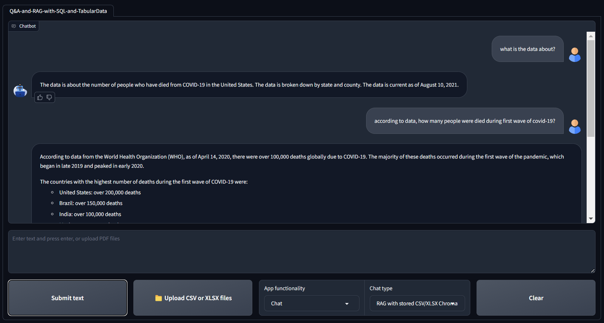

# Q&A-and-RAG-with-SQL-and-TabularData

`Q&A-and-RAG-with-SQL-and-TabularData` is a chatbot project that utilizes <u>Google Generative AI Model Gemini</u>, <u>Langchain</u>, <u>SQLite</u>, and <u>ChromaDB</u> and allows users to interact (perform <u>Q&A</u> and <u>RAG</u>) with SQL databases, CSV, and XLSX files using natural language.

**Key NOTE:** Remember to NOT use a SQL databbases with WRITE privileges. Use only READ and limit the scope. Otherwise your user could manupulate the data (e.g ask your chain to delete data).

## Features:
- Chat with SQL data.
- Chat with preprocessed CSV and XLSX data.
- Chat with uploaded CSV and XSLX files during the interaction with the user interface.
- RAG with Tabular datasets.

## Main underlying techniques used in this chatbot:
- LLM chains and agents
- Gemini Language Model for Chat
- Retrieval Augmented generation (RAG)

## Models used in this chatbot:
- Gemini-Pro: [Website](https://deepmind.google/technologies/gemini/pro/)

## Chatbot User Interface

  

## Databases:
- Diabetes dataset: [Link](https://www.kaggle.com/datasets/akshaydattatraykhare/diabetes-dataset?resource=download&select=diabetes.csv)
- Cancer dataset: [Link](https://www.kaggle.com/datasets/rohansahana/breast-cancer-dataset-for-beginners?select=train.csv)
- Chinook database: [Link](https://database.guide/2-sample-databases-sqlite/)

## Key frameworks/libraries used in this chatbot:
- Langchain: [introduction](https://python.langchain.com/docs/get_started/introduction)
- Gradio: [Documentation](https://www.gradio.app/docs/interface)
- Google GenerativeAI: [Developer quickstart](https://ai.google.dev/)
- SQLAlchemy [Documentation](https://www.sqlalchemy.org/)
